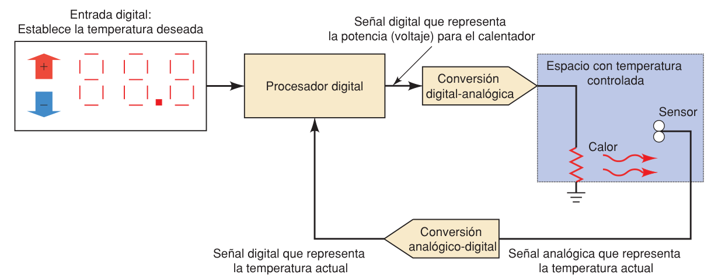

**Índice: [10_Indice_y_Resumen](10_Indice_y_Resumen.md)**

# Analógico vs. Digital

## 1-1 Representaciones numéricas

|          | Analógica                                                                                        | Digital                                      |
| -------- | ------------------------------------------------------------------------------------------------ | -------------------------------------------- |
| Valores  | **Continuos** (cualquier valor en un intervalo)                                                  | **Discretos** (paso por paso, con dígitos)   |
| Lectura  | Abierta a interpretación                                                                         | Sin ambigüedad                               |
| Ejemplos | Velocímetro de aguja, termómetro de mercurio, voltaje de un micrófono (0–10 mV: 2.3724 mV, etc.) | Reloj digital, interruptor de 10 posiciones. |

- **Digitalizar** = asignar un número de precisión limitada a una cantidad continua (ej. leer 36.7 °C en un termómetro de mercurio).
- En sistemas eléctricos analógicos, la cantidad física se convierte en un **voltaje o corriente proporcional**.

## 1-2 Sistemas digitales y analógicos

- **Sistema digital:** dispositivos que manipulan información en forma digital (valores discretos). Ej.: computadoras, calculadoras, audio/video digital, sistema telefónico.
- **Sistema analógico:** manipula cantidades que varían continuamente. Ej.: amplificadores de audio, receptor de radio, regulador de luz.

### Ventajas de las técnicas digitales
1. **Más fáciles de diseñar:** son circuitos de conmutación; importa el intervalo (ALTO/BAJO), no el valor exacto.
2. **Fácil almacenar información** (miles de millones de bits en poco espacio).
3. **Mayor precisión y exactitud:** una señal digitalizada no se deteriora al procesarse (en analógico influyen temperatura, humedad, tolerancias).
4. **Programables:** se controlan con un conjunto de instrucciones almacenadas (programa).
5. **Más resistentes al ruido:** mientras se distinga ALTO de BAJO, el ruido no afecta.
6. **Mayor integración en CI** (los analógicos requieren capacitores grandes, inductores, transformadores, resistencias de precisión, difíciles de integrar).

### Limitaciones
1. **El mundo real es analógico** (temperatura, presión, posición, velocidad, nivel, flujo…).
2. **Procesar señales digitales toma tiempo** (más precisión = más tiempo), y las conversiones agregan complejidad y costo.

> Hay casos donde lo analógico sigue siendo más simple/rápido.
> **Tendencia en sistemas híbridos:** digitalizar la señal **lo más pronto posible** y reconvertirla a analógica **lo más tarde posible**.

### Los 4 pasos para procesar variables analógicas con técnica digital
1. Convertir la variable física en señal eléctrica analógica (**sensor**).
2. Convertir la señal analógica a digital (**ADC**).
3. **Procesar** la información digital.
4. Convertir la salida digital a analógica (**DAC**).

### Fig. 1-1: control de temperatura (flujo)

### Ejemplo: grabación de audio (CD)
Micrófono (señal analógica) → **ADC** → información digital en el CD → reproductor lee → **DAC** → amplificador → bocina.

**Convertidores ADC y DAC** enlace

**Siguiente sección: [12_Sistemas_Numericos](12_Sistemas_Numericos.md)**
