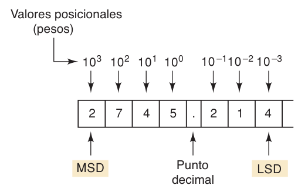

**Índice: [10_Indice_y_Resumen](10_Indice_y_Resumen.md)**

**Sección anterior: [11_Analogico_y_Digital](11_Analogico_y_Digital.md)**

# Sistemas numéricos y binario

## 1-3 Sistemas numéricos digitales

Los más comunes: **decimal, binario, octal y hexadecimal** (octal y hex se ven en el cap. 2).

### Sistema decimal (base 10)
- Símbolos: 0–9. Es de **valor posicional**: el peso de cada dígito depende de su posición (potencias de 10).
- **MSD** = dígito más significativo (más a la izquierda); **LSD** = menos significativo (más a la derecha).
- Ejemplo (Fig. 1-3): 2745.214 = 2·(10³) + 7·(10²) + 4·(10¹) + 5·(10⁰) + 2·(10⁻¹) + 1·(10⁻²) + 4·(10⁻³)
- Con **N dígitos** se cuentan **10^N** números distintos (0 a 10^N − 1).



### Sistema binario (base 2)
- Símbolos: **0 y 1**. También es posicional (potencias de 2).
- ¿Por qué binario? Es muy fácil diseñar circuitos simples y precisos con **solo dos niveles de voltaje**; con 10 niveles sería muy difícil.
- **Bit** = dígito binario. **MSB** = bit más significativo (izquierda), **LSB** = bit menos significativo (derecha).
- Se usan subíndices para indicar la base: 1011.101₂ = 11.625₁₀

### Conversión binario → decimal
Suma de (bit × peso de su posición):

```
1011.101₂ = 1·2³ + 0·2² + 1·2¹ + 1·2⁰ + 1·2⁻¹ + 0·2⁻² + 1·2⁻³
          = 8 + 0 + 2 + 1 + 0.5 + 0 + 0.125
          = 11.625₁₀
```

Tabla de pesos útil:

| 2⁷ | 2⁶ | 2⁵ | 2⁴ | 2³ | 2² | 2¹ | 2⁰ | 2⁻¹ | 2⁻² | 2⁻³ |
|---|---|---|---|---|---|---|---|---|---|---|
| 128 | 64 | 32 | 16 | 8 | 4 | 2 | 1 | 0.5 | 0.25 | 0.125 |

### Conteo binario (4 bits)

| Dec | 2³ | 2² | 2¹ | 2⁰ |
|---|---|---|---|---|
| 0 | 0 | 0 | 0 | 0 |
| 1 | 0 | 0 | 0 | 1 |
| 2 | 0 | 0 | 1 | 0 |
| 3 | 0 | 0 | 1 | 1 |
| 4 | 0 | 1 | 0 | 0 |
| 5 | 0 | 1 | 0 | 1 |
| 6 | 0 | 1 | 1 | 0 |
| 7 | 0 | 1 | 1 | 1 |
| 8 | 1 | 0 | 0 | 0 |
| 9 | 1 | 0 | 0 | 1 |
| 10 | 1 | 0 | 1 | 0 |
| 11 | 1 | 0 | 1 | 1 |
| 12 | 1 | 1 | 0 | 0 |
| 13 | 1 | 1 | 0 | 1 |
| 14 | 1 | 1 | 1 | 0 |
| 15 | 1 | 1 | 1 | 1 |

**Patrón:** el LSB alterna en cada conteo; el siguiente bit alterna cada 2 conteos; el siguiente cada 4; luego cada 8… En general, el bit de la posición *n* alterna en grupos de **2^(n−1)**.

### Fórmulas clave
- Con **N bits** se pueden hacer **2^N conteos** (de 0 a 2^N − 1).
- **Máximo valor con N bits = 2^N − 1** (todos los bits en 1).
  - 4 bits → 15
  - 8 bits → 255 (11111111₂)
  - 10 bits → 1023
  - 12 bits → 4095
  - 14 bits → 16383
- **Bits necesarios para contar hasta X:** el menor N tal que 2^N − 1 ≥ X (ej. hasta 511 → 9 bits; hasta 63 → 6 bits).

**Para más información de este tema: [21_Conversiones_y_Hexadecimal](../02_Sistemas_y_Codigos_Numericos/21_Conversiones_y_Hexadecimal.md)**

**Siguiente sección: [13_Senales_Transmision_Memoria_y_Computadoras](13_Senales_Transmision_Memoria_y_Computadoras.md)**
