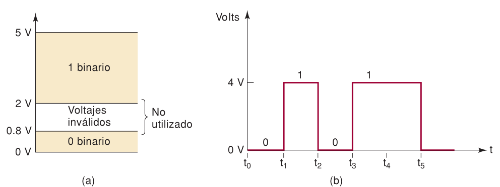
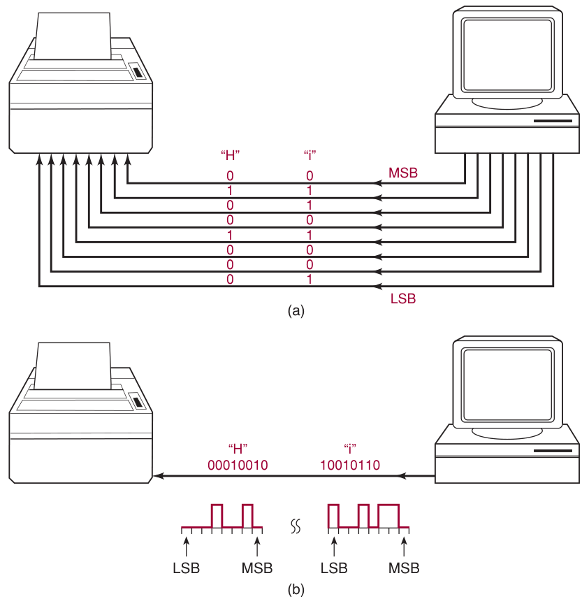
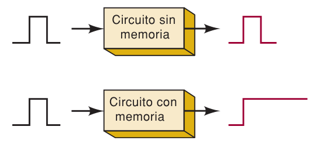
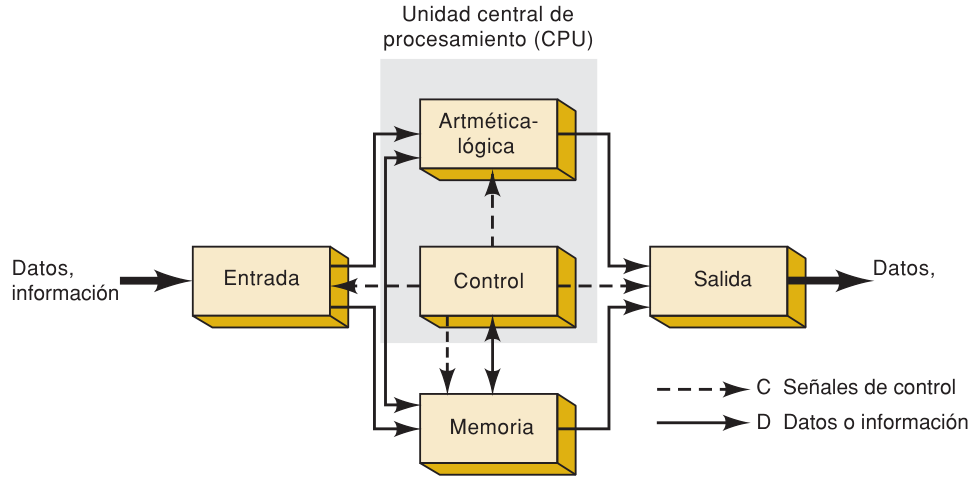

**Índice: [10_Indice_y_Resumen](10_Indice_y_Resumen.md)**

**Sección anterior: [12_Sistemas_Numericos](12_Sistemas_Numericos.md)**

# Señales, transmisión, memoria y computadoras

## 1-4 Representación de cantidades binarias
Cualquier dispositivo con **dos estados** puede representar un bit: interruptor (abierto/cerrado), foco (encendido/apagado), diodo (conduce/no conduce), transistor (corte/saturación), fotocelda, área de disco magnético (magnetizada/no), pozos en un CD (pozo = 1, reflectora = 0).

### Niveles de voltaje
En electrónica digital el 0 y el 1 son **intervalos** de voltaje, no valores exactos (ejemplo con sistema de 5 V):

| Intervalo | Significado |
|---|---|
| 0 V – 0.8 V | **0 binario** (BAJO) |
| 0.8 V – 2 V | **Inválido / no utilizado** (solo ocurre durante transiciones) |
| 2 V – 5 V | **1 binario** (ALTO) |

**Diferencia clave:** en digital, 3.6 V = 4.3 V (ambos son "1"). En analógico, la magnitud exacta del voltaje **sí lleva información**; por eso es más difícil diseñar circuitos analógicos precisos (afectan componentes, temperatura y ruido).

### Diagrama de tiempos
Gráfica de **voltaje vs. tiempo** que muestra cómo cambia una señal digital (en el ejemplo: 0 V en t0–t1, sube a 4 V en t1, baja en t2, sube en t3 y se mantiene hasta t5).
- Las transiciones se dibujan verticales aunque no son instantáneas.
- Se usan para ver la relación entre varias señales y para **pruebas y detección de fallas** (con osciloscopio o analizador lógico).

## 1-5 Circuitos digitales / lógicos
- Producen salidas dentro de los intervalos de 0 y 1 y responden igual a **cualquier entrada dentro del mismo intervalo** (Dos entradas con voltajes distintos pero mismo nivel binario → misma salida).
- **Lógica del circuito** = relación entrada/salida; por eso también se les llama **circuitos lógicos**.
- Casi todos son **circuitos integrados (CI)**. Tecnologías principales:
  - **TTL:** transistor bipolar como elemento principal.
  - **CMOS:** MOSFET de enriquecimiento como elemento principal.
  - También **NMOS** y **ECL**.

## 1-6 Transmisión en paralelo y en serie

- a) **Paralelo** (ej. puerto LPT1 a impresora): los 8 bits van **al mismo tiempo**, 1 línea por bit.

- b) **Serie** (ej. puerto COM, USB): **un bit a la vez** por una sola línea, empezando por el LSB.

| | Paralelo | Serie |
|---|---|---|
| Velocidad | **Más rápida** | Más lenta |
| Líneas de señal | Muchas (1 por bit) | **Una** |
| Circuito | Más complejo/cableado | Más simple |

**Resumen:** paralelo = rápido pero más líneas; serie = menos líneas pero más lento. Esta comparación se repite a lo largo del libro.

## 1-7 Memoria
- **Sin memoria:** al quitar la entrada, la salida regresa a su estado original.
- **Con memoria:** la salida **cambia con la entrada y se queda en el nuevo estado** aunque la entrada desaparezca (retiene la respuesta a una entrada momentánea).
- Sirve para almacenar números binarios temporal o permanentemente, con posibilidad de modificarlos.
- Tipos: magnética, óptica y circuitos electrónicos de fijación (**latches** y **flip-flops**).

**Principales dispositivos digitales con memoria en:**

- [51_Latches_NAND_NOR_Pulsos](../05_Latches_y_Flip_Flops/51_Latches_NAND_NOR_Pulsos.md)
- [52_Flip_Flops_SR_JK_D_Asincronas](../05_Latches_y_Flip_Flops/52_Flip_Flops_SR_JK_D_Asincronas.md)

## 1-8 Computadoras digitales
Una computadora es un sistema de hardware que **realiza operaciones aritméticas, manipula datos (binarios) y toma decisiones**. Ejecuta un paso a la vez, pero en nanosegundos (ej. sumar 10 números = 9 sumas de 2 en 2). Necesita un **programa** (instrucciones codificadas en binario guardadas en memoria) que le diga exactamente qué hacer.

### Las 5 unidades funcionales

| Unidad | Función |
|---|---|
| **Entrada** | Introduce instrucciones y datos (teclado, disco) |
| **Memoria** | Guarda instrucciones, datos y resultados; alimenta a la salida |
| **Control** | Toma instrucciones de memoria una por una, las interpreta y envía señales de control/sincronización a las demás unidades |
| **Aritmética-lógica (ALU)** | Realiza cálculos y decisiones lógicas; guarda resultados en memoria |
| **Salida** | Presenta resultados (impresora, pantalla, proceso) |

**CPU = Unidad de control + Unidad aritmética-lógica.**

### Tipos de computadoras
| Término | Definición |
|---|---|
| **Microprocesador** | CPU completa en **un solo circuito integrado** |
| **Microcomputadora** | Computadora que usa un microprocesador como CPU (PC, PDA…): **propósito general**, depende del software |
| **Microcontrolador** | Microcomputadora **dedicada** (CPU + memoria + puertos E/S en un solo CI) para una tarea de control; no la programa el usuario final. También llamado **controlador embebido** (hornos, ABS, cajeros, electrodomésticos, instrumentación médica…) |

## Palabras clave
bit · circuitos digitales/lógicos · ADC · DAC · diagrama de tiempos · memoria · microcomputadora · microcontrolador · microprocesador · programa · sistema analógico/digital · sistema binario/decimal · transmisión en paralelo/serie · CPU · unidad aritmética-lógica · unidad de control/entrada/memoria/salida

**Siguiente capítulo: [20_Indice_y_Resumen](../02_Sistemas_y_Codigos_Numericos/20_Indice_y_Resumen.md)**
