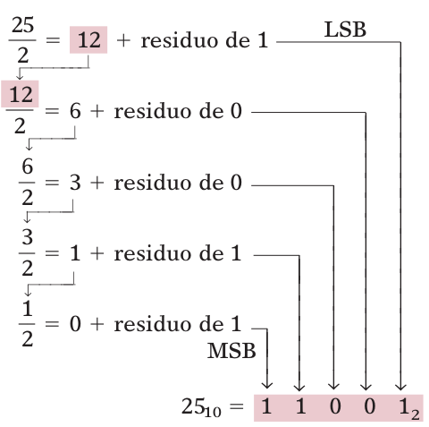

**Indice: [[20_Indice_y_Resumen]]**
# Conversiones y hexadecimal

## 2-1 Binario → decimal
Sumar los **pesos (potencias de 2)** de las posiciones que tengan un 1. El LSB es el primer bit y pesa 2⁰ (por eso en un número de 8 bits el MSB pesa 2⁷).

```
11011₂ = 2⁴ + 2³ + 0 + 2¹ + 2⁰ = 16 + 8 + 2 + 1 = 27₁₀
10110101₂ = 2⁷ + 2⁵ + 2⁴ + 2² + 2⁰ = 128 + 32 + 16 + 4 + 1 = 181₁₀
```

## 2-2 Decimal → binario

### Método 1: suma de potencias de 2
Expresar el número como suma de potencias de 2 y poner 1 donde se usa la potencia y **0 en las demás** (todas las posiciones deben contarse).

```
45₁₀ = 32 + 8 + 4 + 1 = 2⁵ + 0 + 2³ + 2² + 0 + 2⁰ = 101101₂
76₁₀ = 64 + 8 + 4     = 2⁶ + 0 + 0 + 2³ + 2² + 0 + 0 = 1001100₂
```

### Método 2: división repetida entre 2
Dividir entre 2 y anotar el **residuo** hasta que el cociente sea 0. **Primer residuo = LSB, último = MSB** (se lee de abajo hacia arriba).

```
25 ÷ 2 = 12  residuo 1  ← LSB
12 ÷ 2 =  6  residuo 0
 6 ÷ 2 =  3  residuo 0
 3 ÷ 2 =  1  residuo 1
 1 ÷ 2 =  0  residuo 1  ← MSB
25₁₀ = 11001₂
```



*Algoritmo de división repetida. Sirve para convertir a **cualquier base** (2, 16, etc.).*

### Alcance de conteo
Con **N bits** se representan los decimales de **0 a 2^N − 1** (2^N valores distintos).
- 8 bits → 0 a 255.
- ¿Bits para llegar a 12,500? 13 bits → 8191 (no alcanza); **14 bits** → 16,383 

## 2-3 Sistema hexadecimal (base 16)

- 16 símbolos: **0–9 y A–F** (A=10, B=11, C=12, D=13, E=14, F=15).
- Pesos: potencias de 16 (16⁰ = 1, 16¹ = 16, 16² = 256, 16³ = 4096…).
- **Cada dígito hex = 4 bits** (un nibble).

### Tabla 2-1: Hex – Decimal – Binario 

| Hex | Dec | Bin | | Hex | Dec | Bin |
|---|---|---|---|---|---|---|
| 0 | 0 | 0000 | | 8 | 8 | 1000 |
| 1 | 1 | 0001 | | 9 | 9 | 1001 |
| 2 | 2 | 0010 | | A | 10 | 1010 |
| 3 | 3 | 0011 | | B | 11 | 1011 |
| 4 | 4 | 0100 | | C | 12 | 1100 |
| 5 | 5 | 0101 | | D | 13 | 1101 |
| 6 | 6 | 0110 | | E | 14 | 1110 |
| 7 | 7 | 0111 | | F | 15 | 1111 |

### Hex → decimal (suma ponderada)
```
2AF₁₆ = 2·16² + 10·16¹ + 15·16⁰ = 512 + 160 + 15 = 687₁₀
356₁₆ = 3·256 + 5·16 + 6 = 768 + 80 + 6 = 854₁₀
B2F₁₆ = 11·256 + 2·16 + 15 = 2863₁₀
1BC2₁₆ = 7106₁₀
```

### Decimal → hex (división repetida entre 16)
Los residuos mayores de 9 se escriben como letras. Se lee de abajo hacia arriba.

```
423 ÷ 16 = 26  residuo 7   ← LSD
 26 ÷ 16 =  1  residuo 10 (A)
  1 ÷ 16 =  0  residuo 1   ← MSD
423₁₀ = 1A7₁₆

214 ÷ 16 = 13  residuo 6
 13 ÷ 16 =  0  residuo 13 (D)
214₁₀ = D6₁₆
```

### Hex ↔ binario (sin cálculos, solo la tabla)

**Hex → binario:** cada dígito se reemplaza por sus 4 bits.
```
9F2₁₆ = 1001 1111 0010 = 100111110010₂
BA6₁₆ = 1011 1010 0110
```

**Binario → hex:** agrupar de **4 en 4 desde la derecha** (rellenar con ceros a la izquierda si falta) y convertir cada grupo.
```
1110100110₂ = 0011 1010 0110 = 3A6₁₆
101011111₂  = 0001 0101 1111 = 15F₁₆
```

### Conteo en hexadecimal
Cada posición va de 0 a F; al llegar a F regresa a 0 y se incrementa la siguiente.

```
38, 39, 3A, 3B, 3C, 3D, 3E, 3F, 40, 41, 42
6F8, 6F9, 6FA, 6FB, 6FC, 6FD, 6FE, 6FF, 700
```

Con **N dígitos hex** se cuentan **16^N** valores (0 a 16^N − 1). Ej.: 3 dígitos → 000 a FFF = 0 a 4095 (4096 valores).

### ¿Para qué sirve el hexadecimal?
Es una **notación abreviada para humanos** de cadenas binarias largas (hasta 64 bits). Es más fácil de leer, escribir y comparar sin errores: `0110111001100111` ↔ `6E67`. **Los circuitos siempre trabajan en binario.**

### Ejemplo 2-4: 378₁₀ a binario de 16 bits (pasando por hex)
378₁₀ = 17A₁₆ = 0001 0111 1010₂ → rellenando a 16 bits: **0000 0001 0111 1010₂**

## Resumen de conversiones

| De → A | Método |
|---|---|
| Binario/Hex → Decimal | Suma ponderada de cada posición |
| Decimal → Binario/Hex | División repetida entre 2 / 16, juntando residuos (Fig. 2-1) |
| Binario → Hex | Grupos de 4 bits → 1 dígito hex |
| Hex → Binario | Cada dígito → 4 bits |

**Siguiente seccion: [[22_BCD_y_gray]]**

