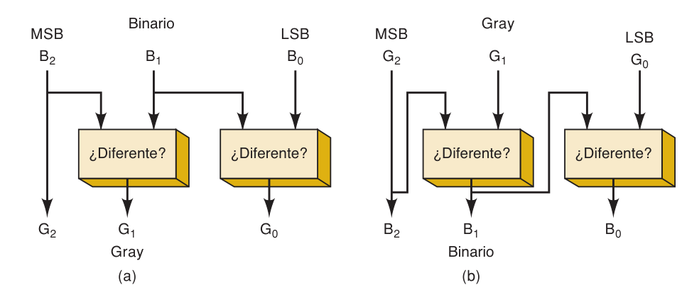
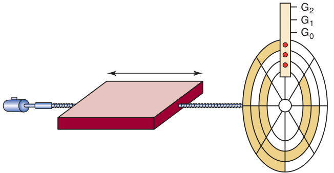

**Índice: [20_Indice_y_Resumen](20_Indice_y_Resumen.md)**

**Sección anterior: [21_Conversiones_y_Hexadecimal](21_Conversiones_y_Hexadecimal.md)**

# BCD y Gray

## 2-4 Código BCD (Decimal Codificado en Binario)

- **Código** = grupo de símbolos que representa información (ej. Morse).
- **Binario directo:** el número decimal **completo** se convierte a binario.
- **BCD:** **cada dígito decimal** se convierte por separado a **4 bits**.

```
8 7 4        9 4 3
1000 0111 0100    1001 0100 0011
```

- Solo se usan los grupos **0000 a 1001**. Los grupos **1010, 1011, 1100, 1101, 1110 y 1111 están prohibidos**; si aparecen, indican un **error**.

**BCD → decimal:** separar en grupos de 4 bits y convertir cada uno.
```
0110 1000 0011 1001 → 6 8 3 9 = 6839
0111 1100 0001      → 7 ✗ 1   (1100 es código prohibido → error)
```

### BCD vs. binario directo
BCD **no es un sistema numérico**, es una forma de codificar decimal.

```
137₁₀ = 10001001₂            (binario directo: 8 bits)
137₁₀ = 0001 0011 0111 (BCD) (12 bits)
```

|         | Ventaja                                                                                          | Desventaja                                                                   |
| ------- | ------------------------------------------------------------------------------------------------ | ---------------------------------------------------------------------------- |
| **BCD** | Conversión muy fácil a/desde decimal (solo se memorizan 10 grupos de 4 bits); simple en hardware | Usa **más bits** (ineficiente, usa solo 10 de las 16 combinaciones posibles) |

Un número decimal de 8 dígitos en BCD = **32 bits**.

## 2-5 Código Gray

- Entre dos números **sucesivos** solo cambia **un bit**.
- **Motivo:** en binario normal varios bits cambian a la vez (ej. 011 → 100 cambia los tres) y un circuito rápido puede malinterpretar el estado intermedio. Con Gray eso no ocurre.

### Tabla binario de 3 bits ↔ Gray

| B2 B1 B0 | G2 G1 G0 |
|---|---|
| 0 0 0 | 0 0 0 |
| 0 0 1 | 0 0 1 |
| 0 1 0 | 0 1 1 |
| 0 1 1 | 0 1 0 |
| 1 0 0 | 1 1 0 |
| 1 0 1 | 1 1 1 |
| 1 1 0 | 1 0 1 |
| 1 1 1 | 1 0 0 |

### Conversión binario → Gray
- El **MSB es igual**.
- Cada bit Gray siguiente = comparar bits binarios vecinos: **iguales → 0, diferentes → 1** (es una XOR).
  - G2 = B2 · G1 = B2 ⊕ B1 · G0 = B1 ⊕ B0

### Conversión Gray → binario
- El **MSB es igual**.
- Cada bit binario = comparar el **bit binario anterior (izquierda)** con el bit Gray correspondiente: **iguales → 0, diferentes → 1**.
  - B2 = G2 · B1 = B2 ⊕ G1 · B0 = B1 ⊕ G0


*Fig. 2-2 – Conversión entre binario y Gray con comparaciones tipo XOR.*

### Aplicación principal: codificadores de posición de eje
Un disco giratorio produce un código binario según su posición angular. Con código Gray, al pasar de un segmento al siguiente solo cambia un bit, evitando lecturas erróneas en los límites.



**Ejemplos (repaso 2-5):** 0101 (binario) → **0111** (Gray) · 0101 (Gray) → **0110** (binario).

## 2-6 Tabla integradora

| Decimal | Binario | Hex | BCD | Gray |
|---|---|---|---|---|
| 0 | 0 | 0 | 0000 | 0000 |
| 1 | 1 | 1 | 0001 | 0001 |
| 2 | 10 | 2 | 0010 | 0011 |
| 3 | 11 | 3 | 0011 | 0010 |
| 4 | 100 | 4 | 0100 | 0110 |
| 5 | 101 | 5 | 0101 | 0111 |
| 6 | 110 | 6 | 0110 | 0101 |
| 7 | 111 | 7 | 0111 | 0100 |
| 8 | 1000 | 8 | 1000 | 1100 |
| 9 | 1001 | 9 | 1001 | 1101 |
| 10 | 1010 | A | 0001 0000 | 1111 |
| 11 | 1011 | B | 0001 0001 | 1110 |
| 12 | 1100 | C | 0001 0010 | 1010 |
| 13 | 1101 | D | 0001 0011 | 1011 |
| 14 | 1110 | E | 0001 0100 | 1001 |
| 15 | 1111 | F | 0001 0101 | 1000 |

**Siguiente sección: [23_Byte_Nibble_Palabra_y_ASCII](23_Byte_Nibble_Palabra_y_ASCII.md)**
