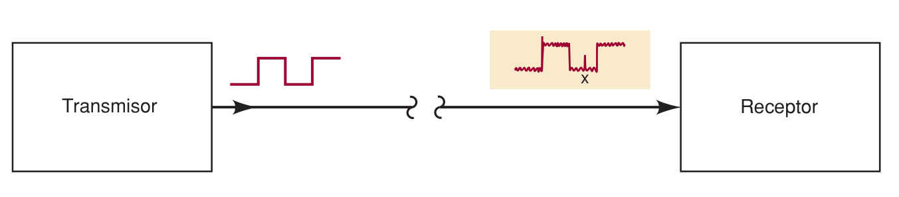

**Índice: [20_Indice_y_Resumen](20_Indice_y_Resumen.md)**
**Sección anterior: [23_Byte_Nibble_Palabra_y_ASCII](23_Byte_Nibble_Palabra_y_ASCII.md)**
# Paridad y aplicaciones

## 2-9 Método de paridad para detección de errores

### ¿Por qué hay errores?
Al transmitir datos (enlace de microondas, memoria externa, módem/Internet…) el **ruido eléctrico** (fluctuaciones espurias de voltaje/corriente) puede alterar un nivel lógico y el receptor interpreta mal un bit. Aunque la probabilidad es muy baja, con millones de bits por segundo ocurre ocasionalmente.

*El ruido en el punto x cambia el nivel lógico del bit recibido.*

### Bit de paridad
Bit **extra** que se agrega al código para que el total de 1s tenga cierta característica.

| Tipo              | Regla                                                | Ejemplo con `1000011` (“C”, tres 1s) | Ejemplo con `1000001` (“A”, dos 1s) |
| ----------------- | ---------------------------------------------------- | ------------------------------------ | ----------------------------------- |
| **Paridad par**   | Total de 1s (incluyendo el bit de paridad) = **par** | bit = **1** → `11000011`             | bit = **0** → `01000001`            |
| **Paridad impar** | Total de 1s = **impar**                              | bit = **0** → `01000011`             | bit = **1** → `11000001`            |

- El bit de paridad suele colocarse a la **izquierda del MSB** y se trata como un bit más del código (ASCII de 7 bits + paridad = 8 bits).
- Transmisor y receptor deben **acordar** antes si usan par o impar (la par se usa más).
- El receptor **comprueba la paridad**: cuenta los 1s y verifica que coincida con el tipo acordado. Si no, hay error y puede pedir retransmisión.

### Limitaciones
- Detecta **errores de un solo bit**, pero **no sabe cuál bit** falló (no corrige).
- **No detecta errores dobles**: dos bits erróneos no cambian si la cantidad de 1s es par o impar.
- Solo es útil cuando la probabilidad de error simple es baja y la de error doble es prácticamente cero.

### Ejemplo 2-15: enviar "HOLA" con ASCII y paridad par

| Carácter | ASCII (7 bits) | # de 1s | Paridad | Byte transmitido |
|---|---|---|---|---|
| H | 1001000 | 2 | 0 | 0100 1000 |
| O | 1001111 | 5 | 1 | 1100 1111 |
| L | 1001100 | 3 | 1 | 1100 1100 |
| A | 1000001 | 2 | 0 | 0100 0001 |

## 2-10 Aplicaciones de los temas vistos desde 2-1

**Aplicación 2-1 – Capacidad de un CD-ROM:** 650 MB × 2²⁰ × 8 bits = **5,452,595,200 bits** (mega = 2²⁰ en sistemas digitales).

**Aplicación 2-2 – Formato Hexadecimal Intel** (para programar microcontroladores). Línea ejemplo: `:10002000F7CF…`
- Se envía en ASCII por el puerto serial; los dos primeros caracteres `:` y `1` llevan paridad par:
  - `:` = 3A → `00111010`; `1` = 31 → `10110001` (MSB = bit de paridad).
- `10` hex = **16 bytes** de datos.
- `0020` = dirección donde se guarda el primer byte; la mayor posible es `FFFF` (**16 bits**).
- Primer byte `F7` → nibble menos significativo `7` = `0111`.

**Aplicación 2-3 – Direcciones de memoria de 16 bits:**
- 16 / 4 = **4 dígitos hex**.
- Intervalo: `0000₁₆` a `FFFF₁₆`.
- Localidades: 16⁴ = **65,536**.

**Aplicación 2-4 – Entrada BCD, almacenamiento en binario directo:**
- 2 dígitos (hasta 99 = `01100011`) → **1 byte**.
- 3 dígitos (hasta 999 = `1111100111`, 10 bits) → **2 bytes**.

## Palabras clave
bit de paridad · byte · códigos alfanuméricos · código binario directo · BCD · ASCII · código Gray · método de paridad · nibble · palabra · sistema numérico hexadecimal · tamaño de palabra

**Siguiete capitulo: [20_Indice_y_Resumen](30_Indice_y_Resumen.md)**
