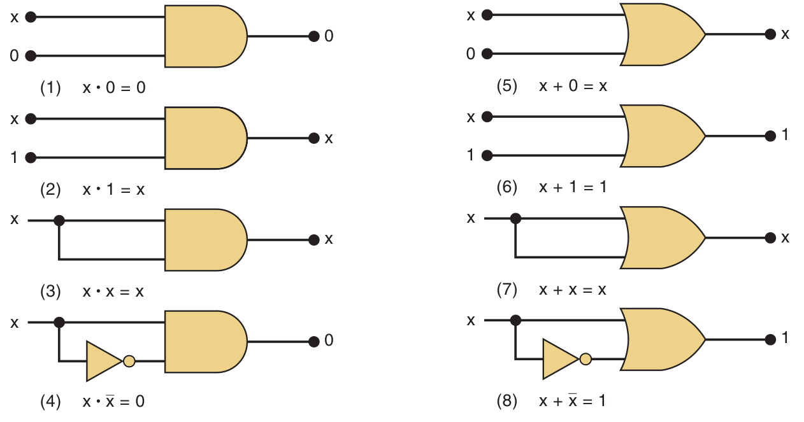
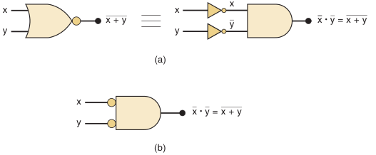
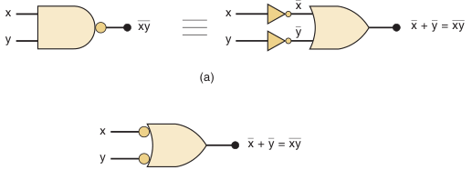
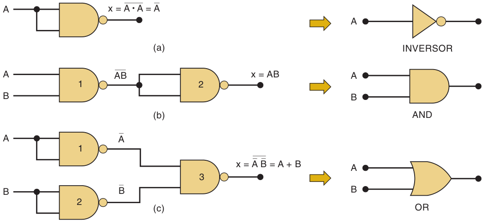
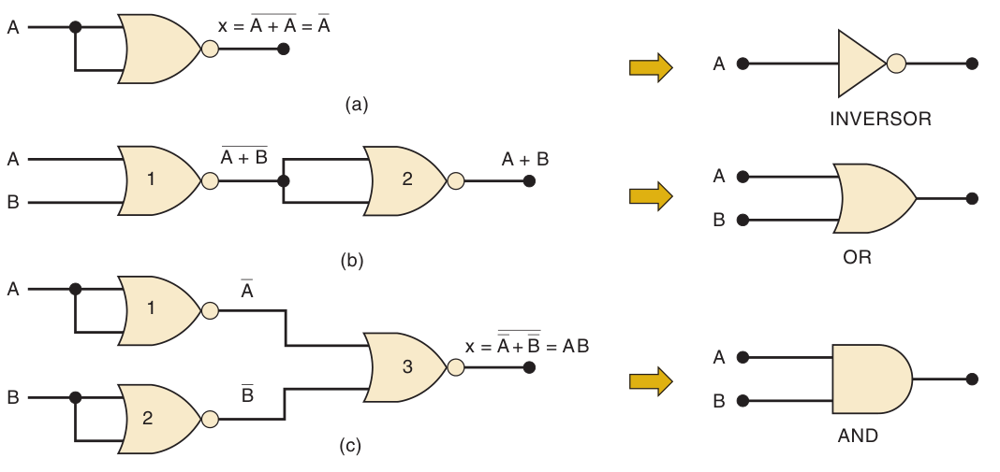
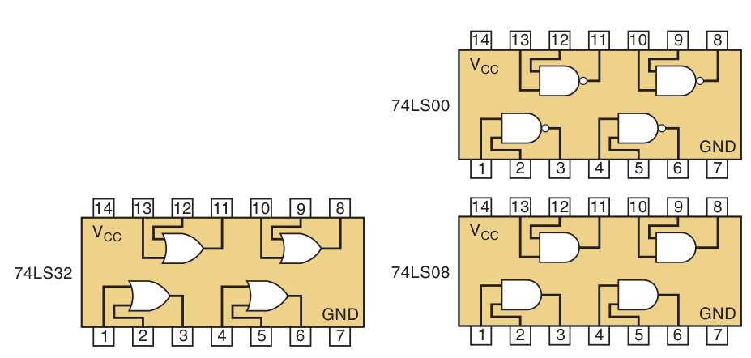
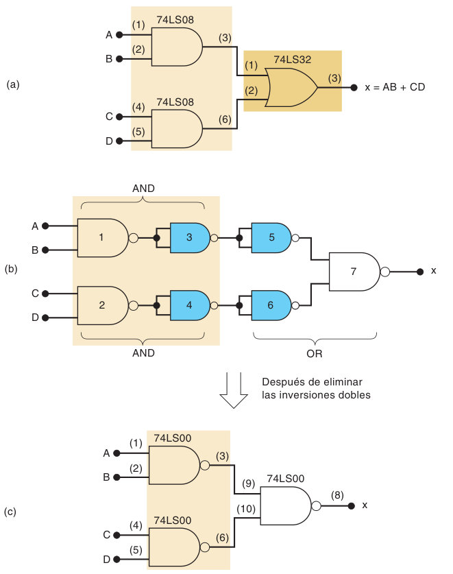

**Índice: [30_Indice_y_Resumen](30_Indice_y_Resumen.md)**

**Sección anterior: [32_Evaluacion_de_Expresiones_NOR_NAND](32_Evaluacion_de_Expresiones_NOR_NAND.md)**

# Teoremas booleanos, DeMorgan y universalidad

## 3-10 Teoremas booleanos
Sirven para **simplificar** expresiones → circuitos con menos compuertas y conexiones (se profundiza en el cap. 4). En cada teorema, `x` puede ser también una **expresión completa**.

### Una sola variable (Fig. 3-25)

| #   | Teorema      | Idea                                |
| --- | ------------ | ----------------------------------- |
| 1   | `x · 0 = 0`  | AND con 0 siempre da 0              |
| 2   | `x · 1 = x`  | AND con 1 no cambia nada            |
| 3   | `x · x = x`  |                                     |
| 4   | `x · x' = 0` | x y su inverso nunca son 1 a la vez |
| 5   | `x + 0 = x`  | OR con 0 no cambia nada             |
| 6   | `x + 1 = 1`  | OR con 1 siempre da 1               |
| 7   | `x + x = x`  |                                     |
| 8   | `x + x' = 1` | siempre uno de los dos es 1         |

### Varias variables

| # | Teorema | Nombre |
|---|---|---|
| 9 | `x + y = y + x` | Conmutativa (OR) |
| 10 | `x · y = y · x` | Conmutativa (AND) |
| 11 | `x + (y + z) = (x + y) + z = x + y + z` | Asociativa (OR) |
| 12 | `x(yz) = (xy)z = xyz` | Asociativa (AND) |
| 13a | `x(y + z) = xy + xz` | **Distributiva** |
| 13b | `(w + x)(y + z) = wy + xy + wz + xz` | Distributiva (expandir término por término) |
| 14 | `x + xy = x` | **Absorción** |
| 15a | `x + x'y = x + y` | |
| 15b | `x' + xy = x' + y` | |

- Los teoremas 9–13 son **idénticos al álgebra ordinaria**. El 14 y el 15 no.
- La ley distributiva también sirve para **factorizar**: `ABC + AB'C = AC(B + B')`; `ABC + ABD = AB(C + D)`.
- Teorema 14 demostrado: `x + xy = x(1 + y) = x · 1 = x` (usando 6 y 2).
- Se puede probar cualquier teorema **comprobando todos los casos** de x y y en una tabla.

### Ejemplos de simplificación
**3-13:** `y = ABD + ABD'` → `AB(D + D') = AB · 1 =` **AB**

**3-14:** `z = (A' + B)(A + B)`
= AA' + AB + A'B + BB = 0 + AB + A'B + B = B(A + A' + 1) = **B**

**3-15:** `x = ACD + A'BCD`  → `CD(A + A'B)` → por 15a `CD(A + B)` = **ACD + BCD**

## 3-11 Teoremas de DeMorgan

Los dos más importantes para manipular expresiones con barras largas:

| # | Teorema | En palabras |
|---|---|---|
| **16** | `(x + y)' = x' · y'` | invertir una **suma** = invertir cada variable y aplicar **AND** |
| **17** | `(x · y)' = x' + y'` | invertir un **producto** = invertir cada variable y aplicar **OR** |

**Regla práctica:** *rompe la barra larga en cualquier punto y **cambia el operador** (· ↔ +)*. Repite hasta que **solo haya variables individuales invertidas**. Las dobles barras se cancelan.

Válidos para **cualquier número de variables** y para x, y que sean expresiones:
- `(x + y + z)' = x'y'z'`
- `(xyz)' = x' + y' + z'`
- `(AB + C)' = (AB)'·C' = (A' + B')C' = A'C' + B'C'`
- `((A + C)(B + D))' = (A + C)' + (B + D)' = A'C' + B'D'`

### Interpretación con circuitos
- **Teorema 16:** una **NOR** ≡ una **AND con inversores (burbujas) en sus entradas**.
- **Teorema 17:** una **NAND** ≡ una **OR con burbujas en sus entradas**.

**Ejemplo 3-17:** `z = (A·B·C')'` → DeMorgan → `A' + B' + C'' =` **A' + B' + C**

## 3-12 Universalidad de NAND y NOR

Con **solo NAND** (o **solo NOR**) se puede construir cualquier circuito lógico.

### Con compuertas NAND

| Función | Construcción |
|---|---|
| **NOT** | NAND con las dos entradas unidas: `(A·A)' = A'` |
| **AND** | NAND seguida de otra NAND como inversor: `((AB)')' = AB` |
| **OR** | invertir A y B con NAND y meterlas a otra NAND: `(A'B')' = A + B` (DeMorgan) |

### Con compuertas NOR

| Función | Construcción                                                               |
| ------- | -------------------------------------------------------------------------- |
| **NOT** | NOR con entradas unidas: `(A + A)' = A'`                                   |
| **OR**  | NOR seguida de NOR como inversor: `((A + B)')' = A + B`                    |
| **AND** | invertir A y B con NOR y meterlas a otra NOR: `(A' + B')' = AB` (DeMorgan) |

### Circuitos integrados TTL disponibles (cada uno **cuádruple**: 4 compuertas por chip):

| CI | Compuertas |
|---|---|
| 74LS00 | NAND |
| 74LS08 | AND |
| 74LS32 | OR |
| 74LS02 | NOR |

- **Implementación directa:** 2 AND + 1 OR → **2 CI** (74LS08 + 74LS32).
- **Con NAND:** reemplazando AND/OR por sus equivalentes con NAND aparecen pares de inversores en serie que se **eliminan** (doble inversión). Queda:
  `x = ((AB)'·(CD)')' = AB + CD` con solo **3 NAND de 2 entradas → 1 solo CI (74LS00)** más eficiente.

**Siguiente sección: [34_Simbolos_Alternos_Activo_Bajo_IEEE](34_Simbolos_Alternos_Activo_Bajo_IEEE.md)**
