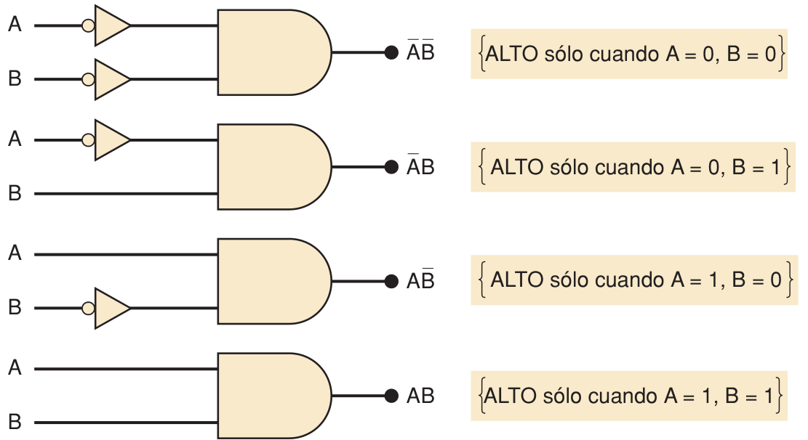
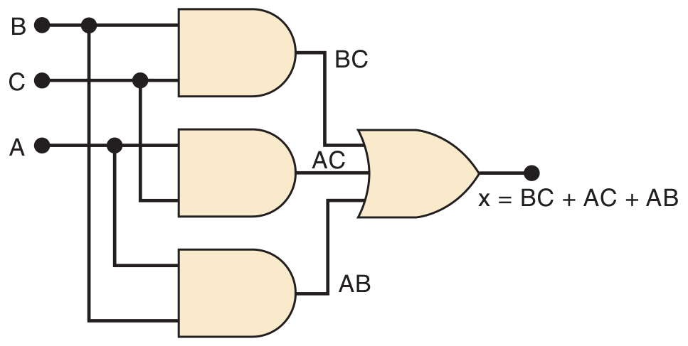
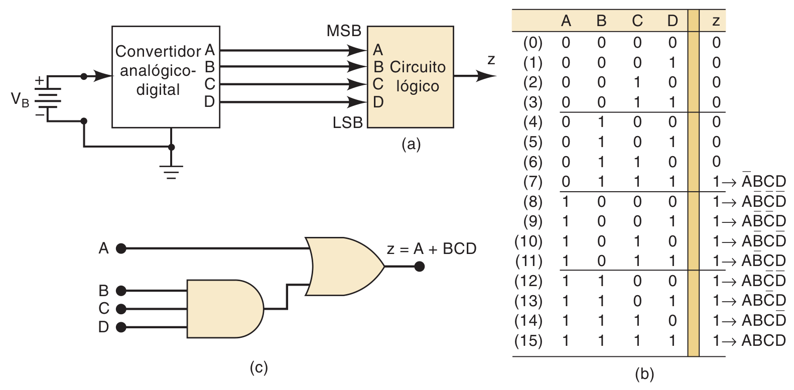
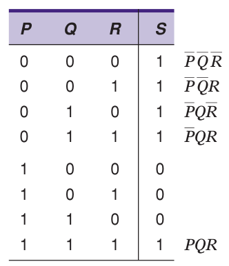
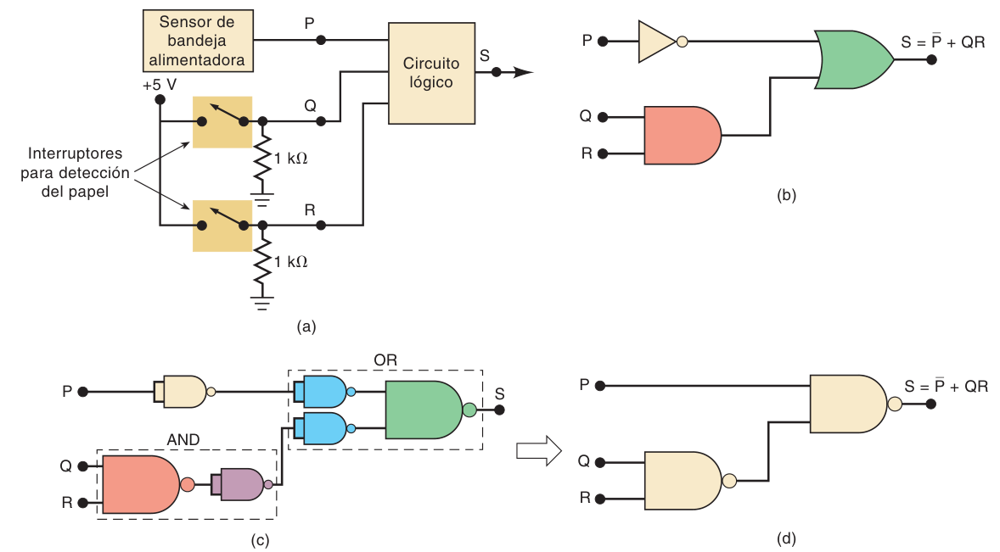

**Índice: [40_Indice_y_Resumen](40_Indice_y_Resumen.md)**

# SOP, simplificación algebraica y diseño

**Circuito combinacional:** en todo momento la salida depende **solo de la combinación actual de las entradas**. **No tiene memoria.**

## 4-1 Forma de suma de productos (SOP) y producto de sumas (POS)

| Forma | Estructura | Ejemplos |
|---|---|---|
| **SOP** (suma de productos) | Varios términos **AND** unidos por **OR** | `ABC' + A'BC` · `AB + CD + EF` · `AB + ABC + CD'` |
| **POS** (producto de sumas) | Varios términos **OR** unidos por **AND** | `(A + B + C)(A + C')` · `(A + B)(C + D)F` |

- Cada término AND tiene variables individuales, complementadas o no.
- **En SOP una barra de inversión no puede cubrir más de una variable en un término.** Por ejemplo, `(RST)'` o `(MN)' + PQ` **no** están en forma SOP.
- El álgebra y los mapas K parten de la forma **SOP**.

## 4-2 Por qué simplificar
Una expresión más simple → **menos compuertas y conexiones** → circuito más pequeño, barato y **más confiable** (menos interconexiones que puedan fallar).

Ejemplo: `x = AB(A' + BC)'` se simplifica a **`x = ABC'`**.

Dos métodos: **álgebra booleana** (depende de experiencia, prueba y error) y **mapeo de Karnaugh** (sistemático, paso a paso).

## 4-3 Simplificación algebraica

**Dos pasos esenciales:**
1. Poner la expresión en **SOP**: aplicar **DeMorgan** repetidamente y **multiplicar** los términos.
2. Buscar **factores comunes** en los productos y **factorizar** para eliminar términos (usando `A + A' = 1`, teoremas 14, 15a, 15b, etc.).

### Ejemplo
`z = ABC + AB'·(A'C')'`
- DeMorgan: `(A'C')' = A + C` → `z = ABC + AB'(A + C)`
- Multiplicar: `= ABC + AB'A + AB'C = ABC + AB' + AB'C`
- Factorizar `AC` del 1.º y 3.º: `= AC(B + B') + AB' = AC + AB'`
- **`z = A(B' + C)`**

### Ejemplo 4-2 (dos métodos)
`z = AB'C' + AB'C + ABC`

- **Método 1:** factorizar `AB'` de los dos primeros: `AB'(C' + C) + ABC = AB' + ABC = A(B' + BC)` → por el teorema 15b → **`z = A(B' + C)`**.
- **Método 2 (truco):** **usar un término dos veces** (`AB'C + AB'C = AB'C`, teorema 7):
  `z = AB'C' + AB'C + AB'C + ABC = AB'(C' + C) + AC(B' + B) = AB' + AC = A(B' + C)`.
- **Truco general:** puedes **repetir un término** las veces que necesites para factorizarlo con distintos vecinos.

### Otras observaciones
- **Busca el factor común más grande** entre términos; llegas al resultado en menos pasos.
- Se puede llegar a expresiones que "parecen irreducibles" y que **no** sean la expresión mínima. No hay manera obvia de saber si te faltó un paso → **el mapa K sí garantiza la forma mínima**.

### Ejemplo
`z = (A + B)(A' + B')` → multiplicar: `AA' + AB' + BA' + BB'` → **`z = A'B + AB'`** (es una **XOR**). Mismas compuertas y conexiones que el original: la simplificación solo lo dejó equivalente y algo más claro.

### Ejemplo
`x = ABC + AB'D + C'D'`: **no se puede simplificar más.**

## 4-4 Diseño de circuitos combinacionales

**Idea base:** cada fila de la tabla de verdad con salida 1 se implementa con una **compuerta AND** que genera 1 solo para esa combinación de entradas; después se une todo con un **OR**.
- Si la variable vale **0** en esa fila, **entra negada** al AND; si vale 1, entra directa.
- Ejemplo: salida 1 solo con A=0, B=1 → `x = A'B`. Salida 1 con (0,1) y (1,0) → `x = A'B + AB'`.



*Cuatro AND, cada una activa para una sola combinación (A,B).*

### Procedimiento completo de diseño (5 pasos)
1. **Interpretar** el problema y escribir la **tabla de verdad**.
2. Escribir el **término AND** para cada fila con salida 1.
3. Escribir la expresión **SOP** (OR de esos términos).
4. **Simplificar** (álgebra o mapa K).
5. **Implementar** el circuito.

### Ejemplo 4-7: salida ALTO cuando la mayoría de A, B, C están en ALTO
Tabla: x = 1 en 011, 101, 110, 111.
`x = A'BC + AB'C + ABC' + ABC`
Se usa el término `ABC` **tres veces** para factorizar con cada otro término:
`x = BC(A' + A) + AC(B' + B) + AB(C' + C)` → **`x = BC + AC + AB`** (tres AND y un OR).



### Ejemplo: ADC de 4 bits y batería de 12 V

Un convertidor analógico-digital está monitoreando el voltaje de corriente directa de una batería de almacenamiento de 12 V. La salida del convertidor es un número binario de 4 bits identificado como ABCD, que corresponde al voltaje de la batería en intervalos de 1 V, en donde A es el MSB. Las salidas binarias del convertidor se alimentan a un circuito lógico que debe producir una salida en ALTO siempre y cuando el valor binario sea mayor que 0110₂ = 6₁₀; esto es, que el voltaje de la batería sea mayor que 6 V. Diseñe este circuito lógico.

- Tabla: z = 1 para los valores 7 a 15 (nueve combinaciones).
- Simplificación algebraica:

```
z = A'BCD + AB'C'D' + AB'C'D + AB'CD' + AB'CD + ABC'D' + ABC'D + ABCD' + ABCD
z = A'BCD + AB'C'(D' + D) + AB'C(D' + D) + ABC'(D' + D) + ABC(D' + D)
  = A'BCD + AB'C' + AB'C + ABC' + ABC
  = A'BCD + AB'(C' + C) + AB(C' + C)
  = A'BCD + AB' + AB
  = A'BCD + A(B' + B)
  = A'BCD + A
  = BCD + A
```



### Ejemplo: copiadora (paro por falta de papel o atasco)

En una copiadora simple, se debe generar una señal de paro S para detener la operación de la máquina y encender una luz indicadora cada vez que exista una de las siguientes condiciones: (1) que no haya papel en la bandeja alimentadora; o (2) que se activen los dos microinterruptores en la ruta del papel, lo cual indica un atasco. La presencia de papel en la bandeja alimentadora se indica mediante un nivel ALTO en la señal lógica P. Cada microinterruptor produce una señal lógica (Q y R, respectivamente) que cambia a ALTO cada vez que el papel pasa por el interruptor y lo activa. Diseñe el circuito lógico para producir un nivel ALTO en la señal de salida S para las condiciones antes mencionadas.

Tabla de verdad:



```
S = P'Q'R' + P'Q'R + P'QR' + P'QR + PQR
S = P'Q'(R' + R) + P'Q(R' + R) + PQR
S = P'Q' + P'Q + PQR
S = P' + PQR
S = P' + QR
```



**Para esta sección se usó:** [33_Teoremas_Demorgan_y_Universalidad](../03_Descripcion_de_Circuitos_Logicos/33_Teoremas_Demorgan_y_Universalidad.md)

**Siguiente sección: [42_Mapas_de_Karnaugh](42_Mapas_de_Karnaugh.md)**
