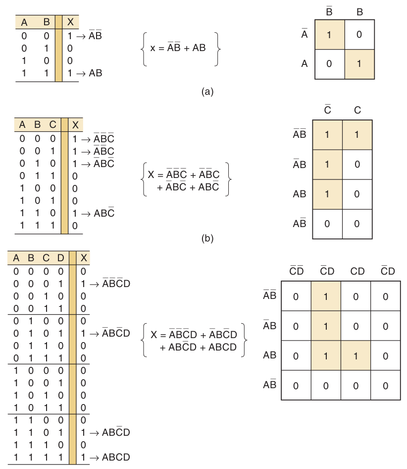
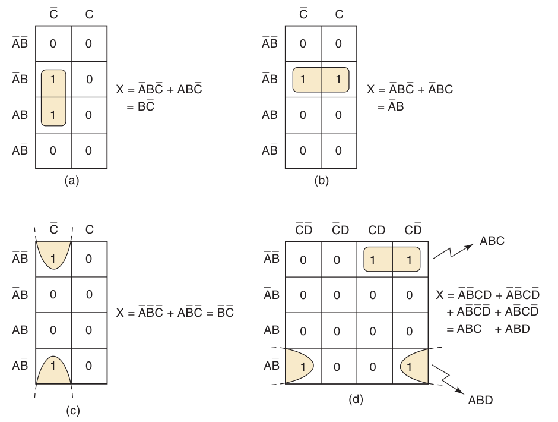
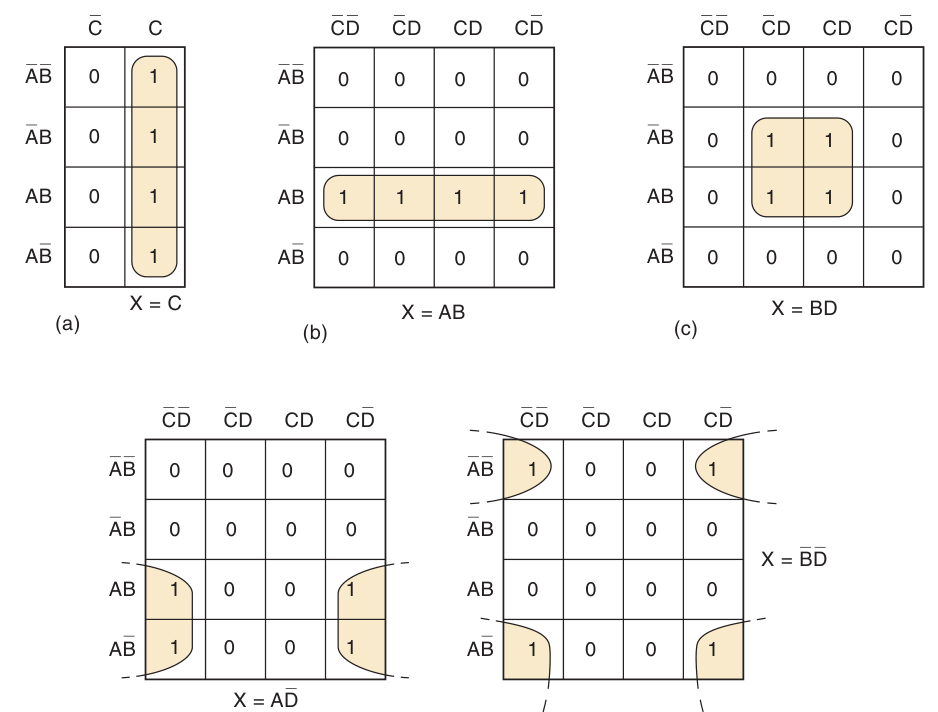
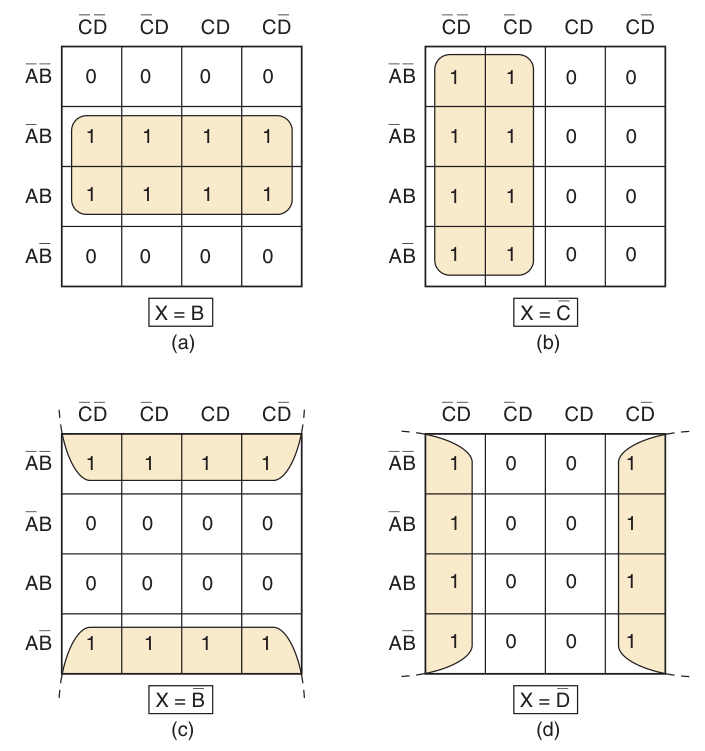
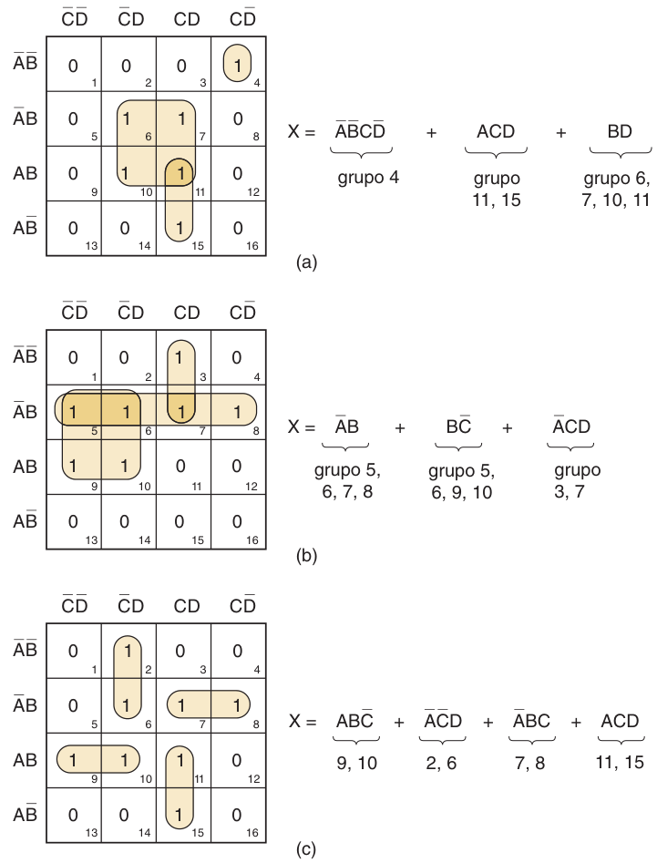
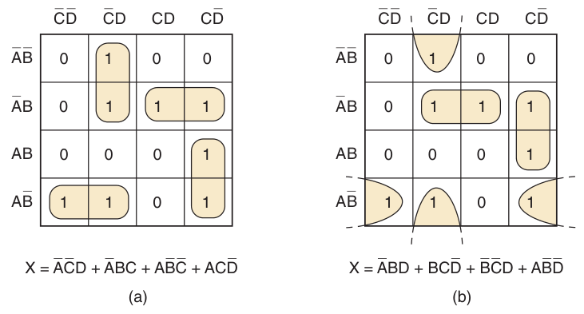
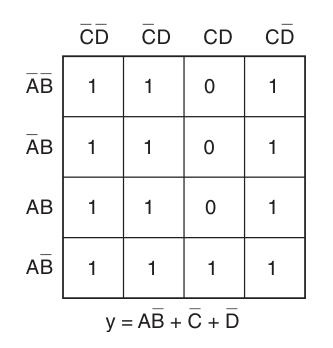
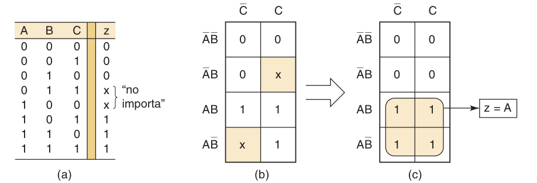
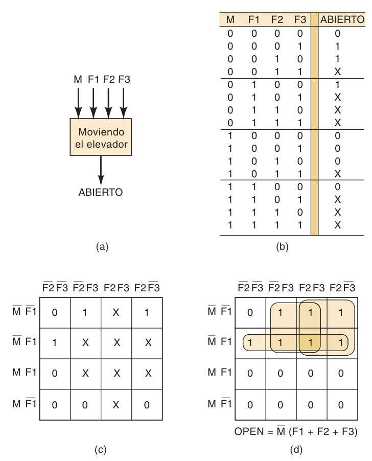

**Índice: [40_Indice_y_Resumen](40_Indice_y_Resumen.md)**

**Sección anterior: [41_Sop_Simplificacion_y_Diseno](41_Sop_Simplificacion_y_Diseno.md)**

# Mapas de Karnaugh

## 4-5 Método de mapas de Karnaugh (mapa K)

Herramienta **gráfica** para simplificar una expresión o pasar de una **tabla de verdad** a un circuito de forma ordenada.
- Útil en la práctica hasta **5 o 6 variables**.

### Formato del mapa
- Cada fila de la tabla de verdad = **una casilla** del mapa. Las casillas con salida 1 llevan un **1**; las demás un **0**.
- Mapas de 2, 3 y 4 variables: 4, 8 y 16 casillas.

**Reglas del etiquetado:**
1. Las casillas **adyacentes** (horizontal o vertical) **difieren en una sola variable**.
2. La **fila superior es adyacente a la inferior** y la **columna izquierda a la derecha** (como si el mapa se doblara). **Los bordes se "envuelven".**
3. Para lograr eso el orden de las etiquetas es **código Gray, no binario**:
   - Filas (AB): `A'B'`, `A'B`, `AB`, `AB'`
   - Columnas (CD): `C'D'`, `C'D`, `CD`, `CD'`
4. La expresión SOP sin simplificar = **OR de todas las casillas con 1**.

### Agrupamiento
Combinar 1s adyacentes **elimina variables** (las que aparecen complementadas y sin complementar dentro del grupo).

| Grupo | Casillas | Variables que elimina |
|---|---|---|
| **Par** | 2 | **1** |
| **Cuádruple** | 4 | **2** |
| **Octeto** | 8 | **3** |

- **Regla:** en un grupo, si una variable aparece **tanto en forma normal como negada, se elimina**; las variables **iguales en todas las casillas del grupo** quedan en el término.
- **Un grupo más grande elimina más variables.**
- Los grupos **no** son diagonales y siempre son potencias de 2 (1, 2, 4, 8).

Ejemplos:
- Par `A'BC + ABC` → `BC` (se elimina A).
- Cuádruple `A'B'C + A'BC + ABC + AB'C` → `C` (se eliminan A y B).
- Octeto en un mapa de 4 variables → queda **una sola variable** (ej. `X = B`).

### Procedimiento completo de simplificación (7 pasos)
1. Construir el mapa y poner **1s** donde la tabla tenga 1, **0s** en el resto.
2. Marcar los **1s aislados** (sin 1s adyacentes): se agrupan solos.
3. Agrupar los 1s que son adyacentes **solo a otro 1** (pares obligados).
4. Agrupar **octetos** (aunque incluyan 1s ya agrupados).
5. Agrupar **cuádruples** que contengan **al menos un 1 aún sin agrupar**, usando el **mínimo de grupos**.
6. Agrupar **pares** para cubrir los 1s restantes, con el **mínimo de grupos**.
7. Hacer el **OR de los términos**, uno por cada grupo.

> Un 1 puede usarse en **más de un grupo**, pero no tiene sentido hacer un grupo cuyos 1s ya estén todos cubiertos por otros.

### Ejemplos del libro (Fig. 4-15 y 4-16, con numeración de casillas 1–16)

| Ejemplo  | Mapa         | Grupos                                                                              | Resultado                                                                                                                                 |
| -------- | ------------ | ----------------------------------------------------------------------------------- | ----------------------------------------------------------------------------------------------------------------------------------------- |
| **4-10** | Fig. 4-15(a) | 1 aislado (casilla 4) · par 11-15 · cuádruple 6-7-10-11                             | `X = A'B'CD' + ACD + BD`                                                                                                                  |
| **4-11** | Fig. 4-15(b) | par 3-7 · cuádruples 5-6-7-8 y 5-6-9-10                                             | `X = A'B + BC' + A'CD`                                                                                                                    |
| **4-12** | Fig. 4-15(c) | pares 9-10, 2-6, 7-8, 11-15 (el cuádruple 6-7-10-11 **no** se agrupa)               | `X = ABC' + A'C'D + A'BC + ACD`                                                                                                           |
| **4-13** | Fig. 4-16    | sin aislados, sin cuádruples; **hay dos soluciones correctas** con 4 pares cada una | (a) `A'C'D + A'BC + ACD' + AB'C'` · (b) `B'C'D + A'BD + BCD' + AB'D'` |

- En el **4-13** ambas soluciones tienen la **misma complejidad**; ninguna es mejor.
- En (b) los grupos aprovechan el **envolvimiento** de bordes (primera/última fila y primera/última columna).

*Fig. 4-15*

*Fig. 4-16*

### Llenar un mapa K a partir de una expresión
1. Pasar la expresión a **SOP**.
2. Para cada término, poner un **1 en todas las casillas** cuyas etiquetas contengan esa combinación. Un término con **menos variables cubre más casillas** (ej. `D'` cubre las dos columnas con D' = 8 casillas). El resto: 0.

**Ejemplo:** `y = C'(A'B'D' + D) + AB'C + D'`
→ SOP: `A'B'C'D' + C'D + AB'C + D'`
→ llenar el mapa
→ **`y = AB' + C' + D'`**

### Condiciones "no importa" (X)
Combinaciones de entrada que **nunca ocurren** o cuya salida da igual. El diseñador **elige 0 o 1** para cada X, según le convenga para formar **grupos más grandes**.
- Se marcan con **X** en la tabla y en el mapa.
- **Convertir en 1** las X que ayudan a agrupar; el resto se toman como 0.

Ejemplo: con una X cambiada a 1 y la otra a 0 se forma un cuádruple y resulta **`z = A`**.

### Ejemplo: puerta de un elevador de 3 pisos

M es una señal lógica que indica cuando se mueve el elevador (M = 1) o cuando está detenido (M = 0). F1, F2 y F3 son señales indicadoras de cada piso que, por lo general, están en BAJO, y cambian a ALTO sólo cuando el elevador está posicionado en ese piso. Por ejemplo, cuando el elevador está alineado con el segundo piso, F2 = 1 y F1 = F3 = 0. La salida del circuito es la señal ABIERTO que, por lo general, está en BAJO y cambia a ALTO cuando se va a abrir la puerta del elevador.

1. Como el elevador no puede alinearse con más de un piso a la vez, sólo una de las entradas de los pisos puede estar en ALTO en un momento dado. Esto significa que todos aquellos casos en la tabla de verdad en los que más de una entrada de piso esté en 1 serán condiciones de "no importa", por lo que podemos colocar una X en dichos casos.
2. Si analizamos los otros ocho casos, cuando M = 1 el elevador se está moviendo, por lo que ABIERTO = 0. Cuando M = 0 (el elevador está detenido) queremos que ABIERTO = 1 siempre y cuando una de las entradas de piso sea 1. Cuando M = 0 y todas las entradas de piso son 0, el elevador está detenido pero no está alineado en forma apropiada con ninguno de los pisos, por lo que queremos que ABIERTO = 0 para mantener la puerta cerrada.

**`ABIERTO = M'(F1 + F2 + F3)`**

### Mapa K vs. álgebra
| Mapa K | Álgebra |
|---|---|
| Proceso **ordenado**, con pasos definidos | **Prueba y error** |
| Menos pasos, sobre todo con muchos términos | Puede ser larguísima |
| **Siempre da una expresión mínima** | No sabes si ya es la mínima |
| Mecánico | Exige más comprensión del álgebra |

Para circuitos con más de 4 entradas se usan técnicas más complejas, normalmente **programas de computadora**.

**Siguiente sección: [43_XOR_XNOR_Paridad_Habilitacion](43_XOR_XNOR_Paridad_Habilitacion.md)**
