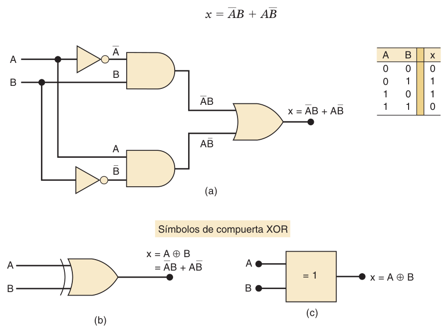
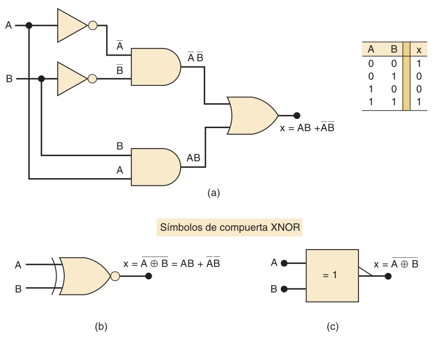
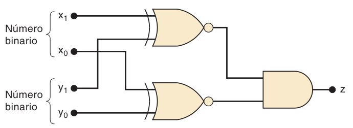
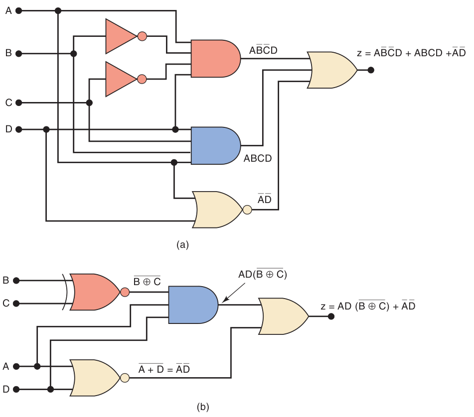
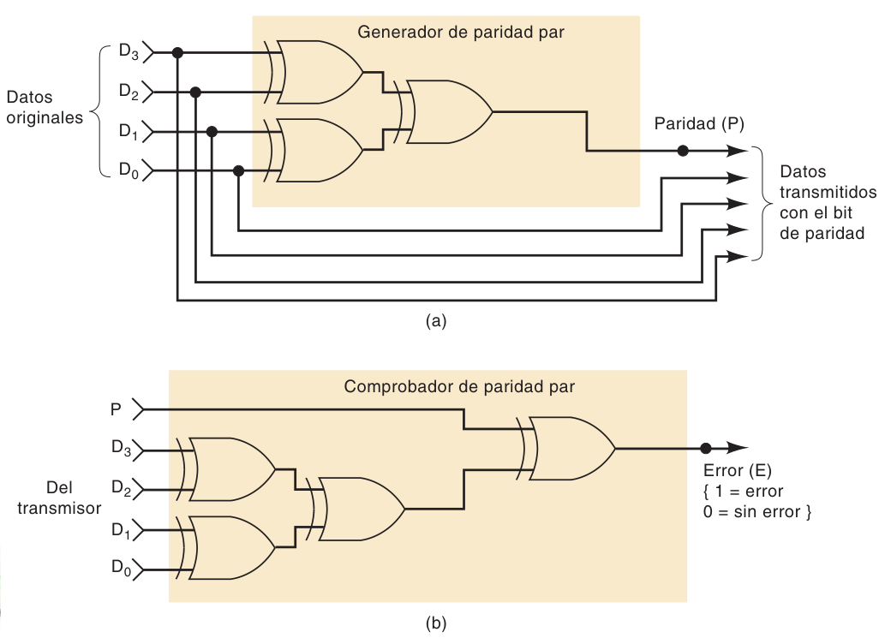
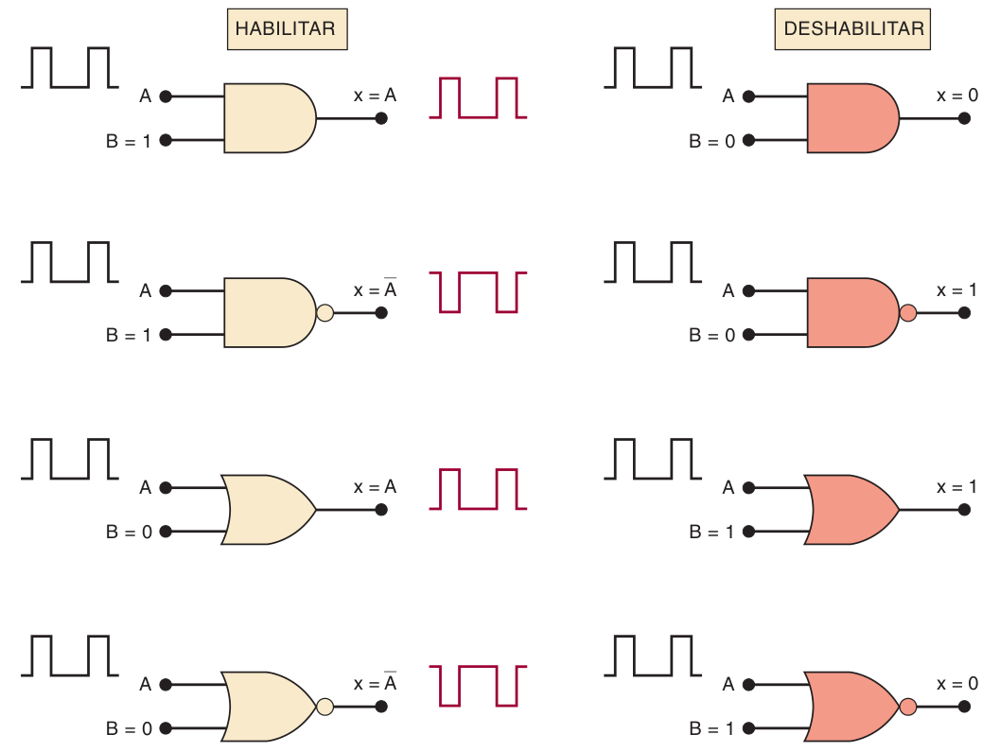
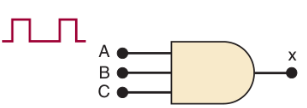
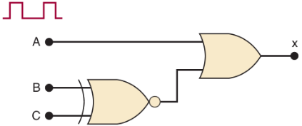
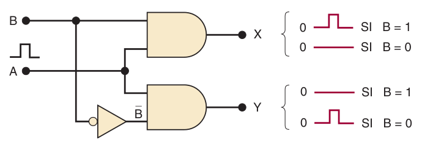

**Índice: [40_Indice_y_Resumen](40_Indice_y_Resumen.md)**

**Sección anterior: [42_Mapas_de_Karnaugh](42_Mapas_de_Karnaugh.md)**

# XOR, XNOR, paridad y habilitación

> **Notación:** `A'` = A negada; `⊕` = XOR.

## 4-6 OR exclusivo (XOR) y NOR exclusivo (XNOR)

### XOR
- Circuito: `x = AB' + A'B`, con símbolo propio.
- **Salida en ALTO cuando las dos entradas están en niveles opuestos.**
- Se abrevia **`x = A ⊕ B`**.

| A   | B   | A ⊕ B |
| --- | --- | ----- |
| 0   | 0   | 0     |
| 0   | 1   | 1     |
| 1   | 0   | 1     |
| 1   | 1   | 0     |

- **Solo tiene 2 entradas** (no existen XOR de 3 o 4 entradas).
- IEEE/ANSI: rectángulo con `=1` (activa en ALTO solo cuando **una** entrada está en ALTO).
- CIs: chips con **cuatro compuertas XOR** (ej. 7486 en TTL, 74HC86 en CMOS).

### XNOR
- Opuesta a la XOR: `x = AB + A'B' = (A ⊕ B)'`.
- **Salida en ALTO cuando las dos entradas están en el mismo nivel.**
- Símbolo: el de XOR con **círculo (burbuja) en la salida** (en IEEE/ANSI, con el triángulo).
- También solo 2 entradas.

| A | B | XNOR |
|---|---|---|
| 0 | 0 | 1 |
| 0 | 1 | 0 |
| 1 | 0 | 0 |
| 1 | 1 | 1 |

- Los CIs XNOR comerciales tienen salidas especiales que limitan su uso, así que es común obtener la función **XNOR con una XOR + un inversor**.

### XOR como "inversor controlado" (ejemplo 4-16)
- Cuando **B = 0**, la salida **sigue a A**.
- Cuando **B = 1**, la salida es **A invertida**.
- ➜ B decide si se invierte o no la señal A.

### Ejemplo: comparador de igualdad de dos números de 2 bits (`x1x0` y `y1y0`)

La salida debe ser 1 solo si `x1 = y1` **y** `x0 = y0`.
- Una tabla de 16 filas daría un SOP largo; es más simple usar **XNOR**:
  - `XNOR(x1, y1)` = 1 si los bits altos son iguales
  - `XNOR(x0, y0)` = 1 si los bits bajos son iguales
  - Una **AND** de ambas salidas → **z = 1 cuando los dos números son iguales**.

### Ejemplo 4-18: XNOR escondida al factorizar
Al factorizar puede aparecer `BC + B'C'`. **No es 1**; sería 1 solo si fuera `BC + BC'`. **`BC + B'C' = B ⊙ C` (XNOR).**
- Reimplementar con una XNOR simplifica el circuito (menos entradas por compuerta, y se eliminan dos inversores).

### Repaso 4-6
1. Demostrar con álgebra que XNOR es el inverso de XOR: `(AB' + A'B)' = AB + A'B'`.
2. XNOR con una señal y su inverso en las entradas → **0** (siempre diferentes).
3. ¿Inversor con un 74HC86 (XOR)? **No hace falta otro chip:** conecta una entrada de la XOR a **1 (ALTO)** y la otra recibe la señal → `x = A ⊕ 1 = A'`.

## 4-7 Generador y comprobador de paridad

Recordatorio del cap. 2: se agrega un **bit de paridad** a los datos para detectar errores de un solo bit.

**Clave:** una **cadena de XOR da 1 si hay un número impar de entradas en 1** y 0 si es par. Ideal para paridad.

### Generador de paridad par (4 bits de datos, Fig. 4-25a)
`P = D3 ⊕ D2 ⊕ D1 ⊕ D0`
→ **P = 1 solo si los datos tienen un número impar de 1s**, de modo que (datos + P) tengan cantidad par de 1s.

| Datos D3D2D1D0 | P |
|---|---|
| 0111 | **1** |
| 1001 | **0** |
| 0000 | **0** |
| 0100 | **1** |

### Comprobador de paridad par (5 bits recibidos)
`E = D3 ⊕ D2 ⊕ D1 ⊕ D0 ⊕ P`
→ **E = 0: sin error. E = 1: hay un número impar de 1s → error** (con paridad par).

- Se adapta fácilmente a **paridad impar** y a **cualquier número de bits**.

## 4-8 Circuitos de habilitación/deshabilitación

Una compuerta puede **dejar pasar o bloquear** una señal A con una **entrada de control B** (de aquí el nombre "compuerta").

| Compuerta | Se **habilita** con B = | Salida habilitada | Salida **deshabilitada** (constante) |
|---|---|---|---|
| **AND** | 1 | **A** (sigue a A) | **0** |
| **OR** | 0 | **A** | **1** |
| **NAND** | 1 | **A'** (inversa de A) | **1** |
| **NOR** | 0 | **A'** | **0** |

- **No inversoras (AND, OR):** habilitadas, la salida **sigue exactamente** a A.
- **Inversoras (NAND, NOR):** habilitadas, la salida es el **inverso** de A.
- **AND y NOR** deshabilitadas → salida constante en **BAJO**.
- **NAND y OR** deshabilitadas → salida constante en **ALTO**.

### Ejemplos de diseño

- **4-21:** Diseñe un circuito lógico que permita que una señal pase a la salida sólo cuando las entradas de control B y C estén ambas en ALTO; en caso contrario, la salida deberá permanecer en BAJO.

> Se usará una compuerta AND, ya que la señal debe pasarse sin invertir y la condición de salida de deshabilitación es un nivel BAJO. Como la condición de habilitación debe ocurrir sólo cuando B = C = 1 se debe usar una compuerta AND de tres entradas.

- **4-22:** Diseñe un circuito lógico que permita que una señal pase hacia la salida sólo cuando una (pero no ambas) de sus entradas de control esté en ALTO; en caso contrario, la salida permanecerá en ALTO.

> Se utiliza una compuerta OR porque queremos que la condición de deshabilitación de la salida sea un nivel ALTO, y no queremos invertir la señal. Las entradas de control B y C se combinan en una compuerta XNOR. Cuando B y C son distintas, la compuerta XNOR envía un nivel BAJO para habilitar la compuerta OR. Cuando B y C son iguales, la compuerta XNOR envía un nivel ALTO para deshabilitar la compuerta OR.

- **4-23:** Diseñe un circuito lógico con la señal de entrada A, la entrada de control B y las salidas X y Y, que opere de la siguiente manera:
  1. Cuando B = 1, la salida X seguirá a la entrada A y la salida Y será 0.
  2. Cuando B = 0, la salida X será 0 y la salida Y seguirá a la entrada A.

**Siguiente sección: [44_CIS_Digitales_y_Diagnostico_Fallas](44_CIS_Digitales_y_Diagnostico_Fallas.md)**
